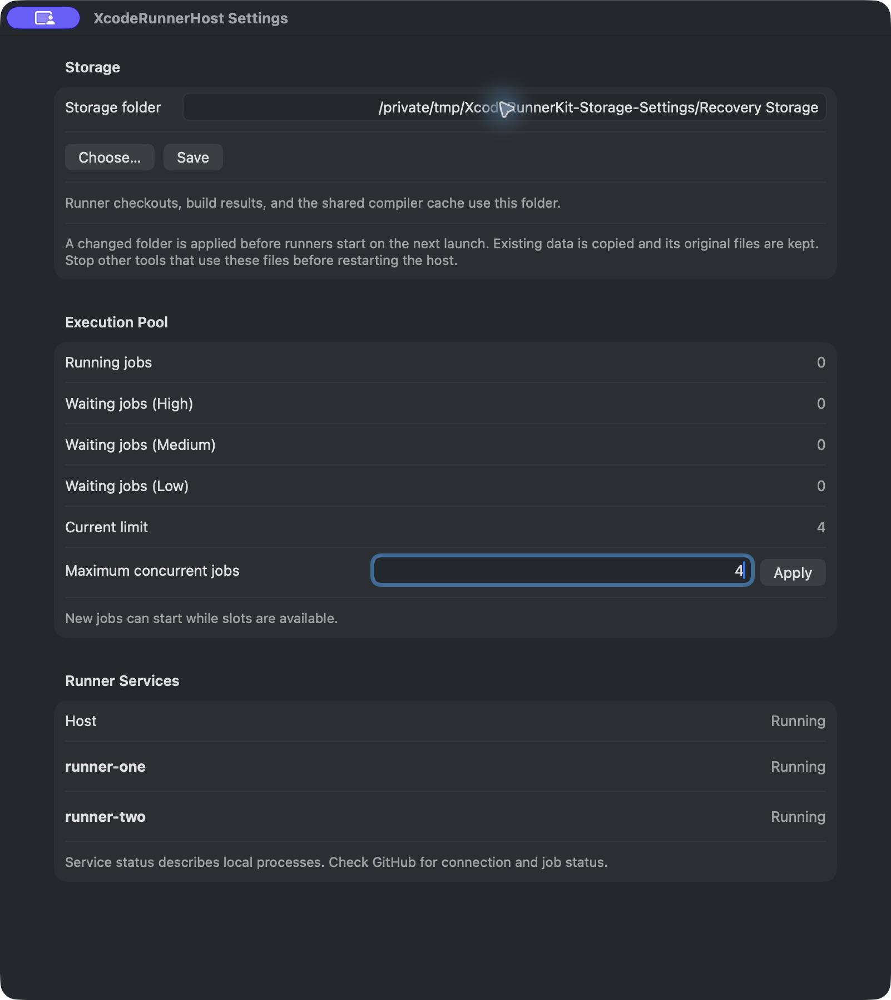

# Native GitHub Actions host

Use one macOS user for the host's repository runners. Each runner has its own
installation and checkout directory; every XcodeRunnerKit operation uses the
same host pool and compiler CAS.

## Prepare the Mac

Use macOS 26 or later, Xcode 27.1 or later, and a GUI login for the CI user.
Keep the Mac connected to power and the lid open. Enable Remote Login if the
host is administered over SSH.

Select Xcode per command or workflow with `DEVELOPER_DIR`; the setup does not
change `xcode-select`. Install the required Simulator runtimes through Xcode.
Check available runtime/device pairs with:

```sh
DEVELOPER_DIR=/Applications/Xcode_27.1.app/Contents/Developer \
xcrun simctl list runtimes --json
```

Projects that compile Metal sources also require the Metal Toolchain:

```sh
DEVELOPER_DIR=/Applications/Xcode_27.1.app/Contents/Developer \
xcodebuild -downloadComponent MetalToolchain
```

Build a verified XcodeRunnerKit checkout and install its executable on the host:

```sh
DEVELOPER_DIR=/Applications/Xcode_27.1.app/Contents/Developer \
swift build -c release --product xcode-runner
bash Scripts/install-host-tools.sh .build/release/xcode-runner \
  "$(git rev-parse HEAD)" /path/to/JobData
```

The optional third argument selects one parent directory for runner work,
compilation cache, and build outputs. Omit it to use the managed default.
Internal tools, credentials, execution pool, and service logs remain in managed
locations under the user's home directory. The installer keeps the previous
executable for rollback and records the source commit. Its user LaunchAgent runs
`caffeinate -i -s` to prevent idle sleep and system sleep on AC power. It requires
the CI user's GUI launchd domain.

## Register repository runners

Install the signed [common host app](#common-host-app) before registering runners.
The installer opts every new repository runner into that host, so its child
processes share one app identity for macOS privacy permissions.

For a personal GitHub account, register runners separately for each repository.
An organization can instead provide organization runners with appropriate
repository access. Register enough listeners to admit jobs from several repos;
the shared pool controls how many Xcode payloads execute.

The installer pins the initial official macOS ARM64 runner to v2.338.0 and
verifies its release asset checksum. Download that archive from
[the official release](https://github.com/actions/runner/releases/tag/v2.338.0).
Copy the archive and the contents of `Scripts` to the CI Mac.

On an authenticated controller with repository administration access, obtain a
short-lived registration token and send it directly to the host installer:

```sh
gh api -X POST repos/OWNER/REPO/actions/runners/registration-token --jq .token |
ssh CI_HOST 'bash "$HOME/Library/Caches/install-github-runner.sh" OWNER/REPO runner-name "$HOME/Library/Caches/actions-runner-osx-arm64-2.338.0.tar.gz"'
```

The controller's GitHub credential stays on the controller. The host keeps the
official runner's generated registration credentials. Each runner is installed
under `~/Library/XcodeRunnerKit/runners/<runner-name>`. Its checkout and temporary
data use `<job-data>/Work/<runner-name>`. Runner installation and hook
paths must contain no whitespace. Work directories use physical absolute paths;
if they contain spaces, quote the script placeholder in every consumer workflow
as shown below. The common host discovers the new registration and starts its
service in the CI user's GUI session.

The default labels include `self-hosted`, `macOS`, `ARM64`, and
`xcode-runnerkit`. The optional fourth argument selects comma-separated custom
labels. Keep the labels selected by consumer workflows in that list; hardware
or host-specific labels belong in the installation configuration.

## Common host app

`XcodeRunnerHost.app` is a menu bar macOS app that starts opted-in official
runner services as child processes. One user LaunchAgent starts the app in the
CI user's GUI session. Runner installations, registration credentials, hooks,
work directories, and the shared compilation cache remain outside its bundle.
The app supplies its active storage and execution pool to descendant CLI commands
and provides a settings window for its live limit. GitHub's listener, service
retries, and automatic updates continue to run in the official runner.

Build with a certificate identity available in the build machine's keychain:

```sh
security find-identity -v -p codesigning
bash Scripts/build-runner-host.sh "SIGNING_IDENTITY" /path/to/output
```

The script builds the `xcode-runner-host` product and signs the app with the
selected identity. An ad-hoc identity (`-`) is useful for packaging tests, but
the installer requires a certificate signature. Keep the same bundle identifier
and signing identity across updates to retain macOS privacy decisions. This
local build procedure does not notarize or publish the app.

Copy the app and setup scripts to the CI Mac. Install the host before opting in
runners:

```sh
bash Scripts/install-runner-host.sh /path/to/XcodeRunnerHost.app
```

The app is installed in `~/Applications`; registration and control directories
are managed automatically. Updating the app stops its services, so first drain
hosted jobs. The previous app is kept
as `XcodeRunnerHost.previous.app`.

Click the hammer icon in the menu bar and choose **Settings…**. The window shows:

- The shared execution limit and currently running XcodeRunnerKit jobs.
- Jobs waiting for an execution slot, counted separately for High, Normal,
  and Low priority. These counts come from the shared pool, including jobs
  submitted through other runner processes.
- Opted-in runners and the state of their local service processes. GitHub
  connection and job status remain available on GitHub.
- The host data, pool, compilation cache, runner installations, service logs,
  and each runner's registered work directory. Folder buttons reveal their
  physical locations in Finder, including cache symlink destinations.



Enter a positive whole number and choose **Apply** to change the execution
limit without restarting the host or runners. Decreasing from six to four
leaves all six running jobs intact. New jobs wait until fewer than four remain,
then start as slots become available. Increasing the limit makes additional
slots available to waiting jobs. The display refreshes every two seconds.
Reading the window does not configure an unused pool; **Apply** explicitly
creates its saved limit if necessary.

Closing the settings window leaves the host and runners running. Storage paths
are shown for inspection. Select the job-data parent during initial setup;
the initializer preserves an existing selection rather than moving live data.

Register another runner with optional custom labels:

```sh
# Supply the registration token on stdin as in the registration example.
bash Scripts/install-github-runner.sh OWNER/REPO runner-name /path/to/runner.tar.gz \
  "xcode-runnerkit"
```

To move an existing runner, drain its jobs, then run:

```sh
bash Scripts/enable-hosted-runner.sh "$HOME/Library/XcodeRunnerKit/runners/runner-name"
```

The script stops and removes its individual LaunchAgent, preserves `.runner`
and registration credentials, and creates `.xcode-runner-host` as the opt-in
marker. It backs up the service path and plist with a `.before-host` suffix.
The host discovers changes within two seconds. A runner with an individual
`.service` is excluded to avoid starting duplicate listeners.
Setup waits for the previous service's processes to exit before enabling host
discovery. Keep `stop-runner-service.py` beside the setup scripts when copying
them to another Mac.

For removable work storage, allow the initial **XcodeRunnerHost** prompt in the
CI user's GUI session. The LaunchAgent associates its process tree with that
app's bundle identifier. The intent is one app-level approval for its runner
children; it does not bypass privacy protection or automatically grant access.
Changing the signing identity or the responsible process can require approval
again. See Apple's [file-system permission guidance](https://developer.apple.com/forums/thread/678819).

Host logs are `<host-root>/logs/runner-host.stdout.log` and
`runner-host.stderr.log`. Each service writes to `logs/runners/<runner-name>.log`.
GitHub's service wrapper owns listener retries. If that wrapper stops after a
permanent failure, inspect its log, resolve the error, and restart the host:

```sh
launchctl kickstart -k "gui/$(id -u)/dev.lynnswap.XcodeRunnerHost"
```

Stopping the host forwards cancellation to the service wrappers and waits for
them. Each service has its own process group, as required by GitHub's macOS
updater. A helper watches the host's process exit and cleans up that service's
group if the host crashes. GUI login remains required; a shared app identity does not
isolate repositories or credentials from other jobs running as the same user.
The host also cleans up a service's group if its helper crashes, before reaping
the helper so its group identifier cannot be reused during cleanup.
The ownership lock is inherited by the service processes. A replacement host
waits for old services to finish shutting down before starting new listeners.

## Storage locations

XcodeRunnerKit explicitly passes `-derivedDataPath`, so Xcode's GUI DerivedData
preference does not select native CI storage. Choose one job-data parent during
initial setup, for example `/Volumes/BuildStorage/CI`:

```sh
bash Scripts/install-host-tools.sh .build/release/xcode-runner \
  "$(git rev-parse HEAD)" /Volumes/BuildStorage/CI
"$HOME/Library/Application Support/XcodeRunnerKit/bin/xcode-runner" host storage status --json
```

Omitting the directory uses
`~/Library/Application Support/XcodeRunnerKit/Storage`. The selected parent has
three managed subdirectories:

| Directory | Contents |
| --- | --- |
| `Work/<runner-name>` | Repository checkouts, dependency checkouts, and runner temporary data. |
| `CompilationCache` | Shared compiler CAS. |
| `Build/<operation-UUID>` | DerivedData, `xcodebuild.log`, and result bundles for one operation. |

Setup creates these directories, checks write access, and preserves their
existing contents. Repeating setup with the same parent updates tools without
moving data. Selecting a different parent after initialization fails before
changing the active configuration; the initializer does not migrate live data.
An existing cache alias is preserved, including its target.

The host captures the active storage and internal control root when it starts.
It passes that snapshot to its runner processes. Their CLI operations use the
managed Build directory, compilation cache, and shared pool without additional
workflow flags. An unused host pool starts with capacity four; its saved limit
takes precedence thereafter. Explicit `--output-directory`,
`--compilation-cache`, and pool options still override these defaults. Standalone
CLI commands retain their own defaults and do not read host configuration.

Keep removable storage mounted while the services run, and allow the initial
**XcodeRunnerHost** volume-access prompt in the GUI session. Work directories
are stored as physical absolute paths because conditional Git credential
includes used by checkout actions do not reliably match symlink aliases.
Each runner gets a separate work directory, and each operation gets separate
DerivedData.

The default Actions bash template does not quote its script placeholder.
For work paths containing spaces, each consumer workflow must select:

```yaml
defaults:
  run:
    shell: 'bash --noprofile --norc -e -o pipefail "{0}"'
```

Choosing a symlink alias to avoid shell quoting can break private-repository
checkout authentication; retain the physical work path.

## Temporary-directory cleanup

The runner installer copies the two `cleanup-runner-temp` scripts into its
host-managed `~/Library/XcodeRunnerKit/hooks/<runner-name>` directory and sets `ACTIONS_RUNNER_HOOK_JOB_COMPLETED` in
`.env`. The completed hook removes symbolic links inside `RUNNER_TEMP` without
following directory links or removing their targets. This prevents the
official runner's parallel deletion from leaving a link behind after its target
has been deleted. Regular files and runner metadata remain for the official
cleanup; the shared CAS is outside `RUNNER_TEMP`.

For an existing runner, copy those scripts to its host-managed hooks directory outside the
runner installation,
set the completed-hook variable to the absolute `.sh` path in `.env`, and
restart the service. Preserve and compose an existing custom completed hook
rather than replacing it. Artifact upload steps run before this hook, including
action post steps. A cleanup error fails the hook and is visible in the job log.
Forcefully terminating the runner can prevent hooks from running.

Check cache configuration, existing-data preservation, and temporary links with:

```sh
DEVELOPER_DIR=/Applications/Xcode_27.1.app/Contents/Developer \
python3 Scripts/check-host-setup.py /absolute/path/to/xcode-runner
```

## Configure private SwiftPM dependencies

Run this from the authenticated controller for each private dependency:

```sh
python3 Scripts/configure-private-dependency.py CI_HOST OWNER/Dependency
```

The helper generates an SSH key on the Mac, registers its public key as a
read-only deploy key for that repository, and configures a dedicated SSH alias.
It uses GitHub's published SSH host keys from the official metadata API.
Existing matching read-only keys are reused; private key material stays on the
Mac. Run setup serially before starting consumers.

Pass these values to the child Xcode operation:

```sh
--environment "SWIFTPM_MIRROR_CONFIG=$ci_root/mirrors.json" \
--environment "GIT_SSH_COMMAND='$ci_root/bin/git-ssh'" \
--environment "GIT_TERMINAL_PROMPT=0"
```

The SwiftPM mirror file matches complete dependency URLs and maps them to
repository-specific SSH aliases. Invoke the helper with the spelling used in
the dependency URL; it retains both that spelling and GitHub's canonical name,
with and without .git. Unmapped dependencies keep their usual HTTPS path.
GIT_SSH_COMMAND must quote the wrapper path: SwiftPM's default for that variable
takes precedence over GIT_SSH.
A workflow's `GITHUB_TOKEN` handles checkout of that workflow's own repository;
it does not grant access to other private dependency repositories. Add a deploy
key mapping before introducing a new private dependency.

## Run workflows

Native consumer workflows execute code trusted by the host owner. Jobs under
the same macOS user share filesystem and credential access; per-job directories,
owned Simulators, and the pool do not isolate malicious code.

XcodeRunnerKit's own public CI uses GitHub-hosted macOS runners for pull requests,
main pushes, and manual dispatches. Do not register this public package on a Mac
that holds private credentials. Use isolated runners for untrusted contribution
workflows; reviewing or merging code does not make the native host a sandbox.

All repositories use:

```sh
ci_root="$XCODE_RUNNER_HOST_ROOT"
exec "$ci_root/bin/xcode-runner" test \
  --package "$GITHUB_WORKSPACE" --scheme PackageName \
  --destination 'platform=macOS,arch=arm64' \
  -- -parallel-testing-enabled NO -jobs 4
```

For iOS, supply the supported Simulator runtime/device identifiers instead of
a macOS destination. Creation, execution, and device deletion hold one slot.
For apps, use the application's workspace and scheme. Consumer-owned plugin
environment values and package paths belong in that consumer's workflow.
Keep mutable SwiftPM checkouts separate between concurrent jobs.

Connect each shell wrapper with `exec` so GitHub sends cancellation signals
directly to the CLI. For example, a workflow calling the script above uses
`run: exec bash .github/scripts/run-tests.sh`. The CLI cancels its Xcode process
group and then deletes its owned Simulator before releasing the pool slot.
Waiting shells do not automatically forward signals to their child commands.

The CLI prints log and result-bundle paths. Consumer workflows should upload
those artifacts with short retention and apply a local retention policy to
`Build`; build outputs are separate from the official runner's temporary-directory
cleanup. Native-host CAS files also stay outside job temporary directories.
The package's hosted CI uses job-local CAS and one-day artifact retention.

## Service operations and recovery

Runner service logs are in
`~/Library/Application Support/XcodeRunnerKit/logs/runners`.
The official runner's `_diag` directory contains listener and worker diagnostics.
Xcode output logs and result bundles are in the operation's output directory.

Inspect or restart the common host in the GUI launchd domain:

```sh
launchctl print "gui/$(id -u)/dev.lynnswap.XcodeRunnerHost"
launchctl kickstart -k "gui/$(id -u)/dev.lynnswap.XcodeRunnerHost"
```

Change the pool limit live from the common host's settings window. Stop accepting
jobs and let active operations finish before pruning caches or updating host
tools. Remove the pool directory only after
all its users have stopped. The first operation initializes the pool capacity;
later workflows use that saved capacity even if their specified value differs.
For cache retention, inspect disk usage and remove an old CAS while its users
are stopped; DerivedData and result retention are separate.

The official GitHub runner retains its normal automatic-update behavior.
Update Xcode and the toolkit during a maintenance window, verify the configured
runtime/device pairing, then run the consumer workflows again. For rollback,
restore both `bin/xcode-runner.previous` and `bin/xcode-runner.commit.previous`
to `bin/xcode-runner` and `bin/xcode-runner.commit` while the runners are stopped.
If the previous executable had no commit marker, the installer leaves no backup
marker; remove the current marker when restoring that executable so diagnostics
do not report the newer revision.

After a host reboot, authenticate FileVault and restore the CI user's GUI
session; user LaunchAgents then start the installed services. On Apple silicon
with macOS 26 or later, Remote Login and available networking also permit
FileVault unlock over SSH. This does not remove the authentication requirement.
See [Apple's FileVault guide](https://support.apple.com/guide/deployment/intro-to-filevault-dep82064ec40/web).
Check the services and GitHub runner online status after recovery.

Managed SIGINT/SIGTERM cancellation tears down Xcode and deletes its owned
Simulator. A forcibly killed wrapper can leave a device behind. Quiesce the
runners, inspect the operation's UDID in its log or failure, and delete only that
identified device after resolving the failure. Keep unrelated devices intact.
